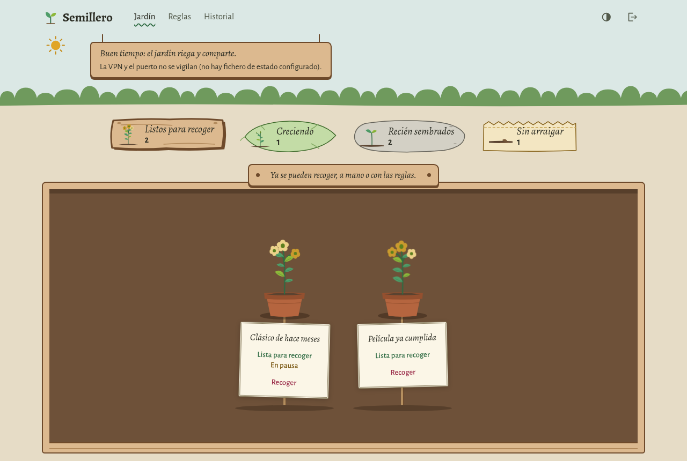
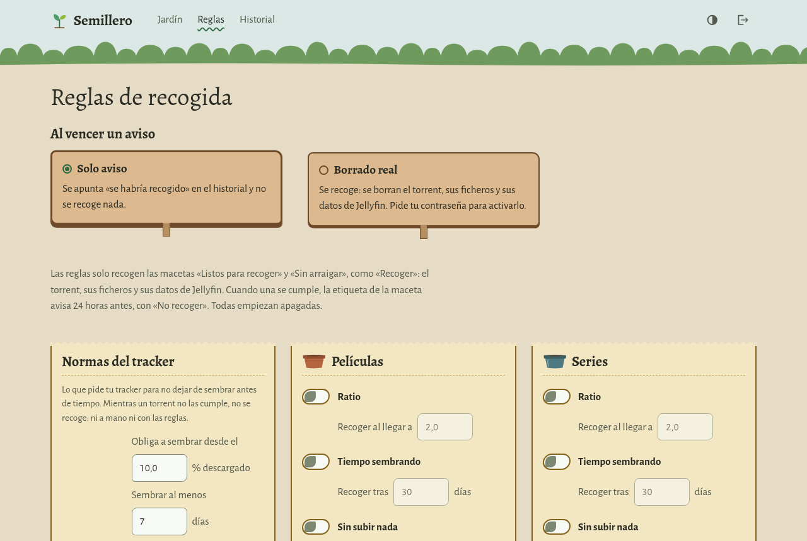
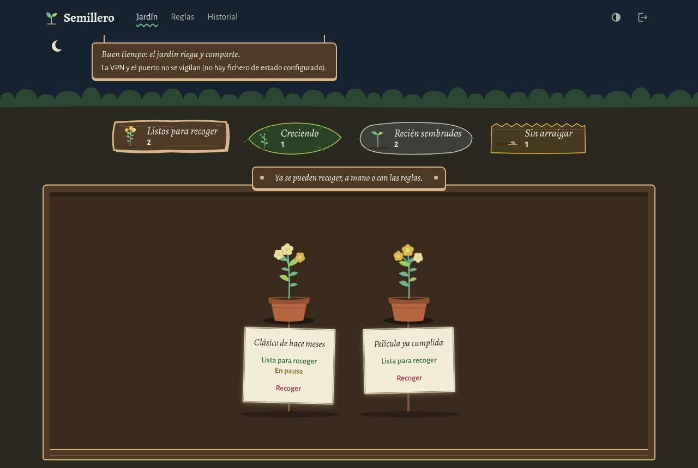
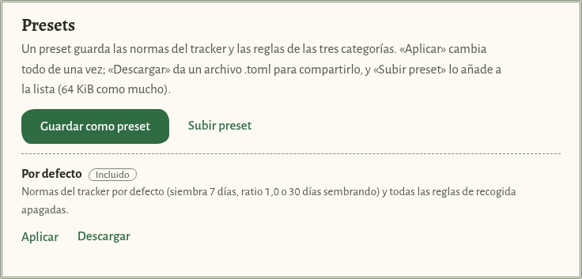
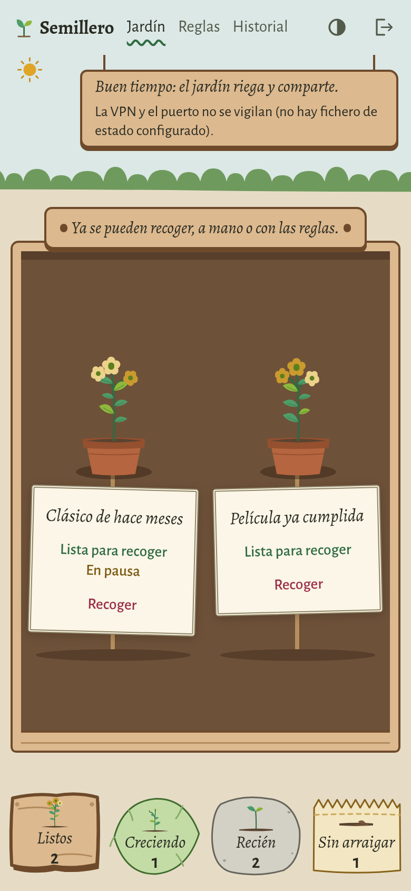

# semillero

[Español](README.md)

A garden for your qBittorrent torrents. semillero tells you which torrents
have met your private tracker's seeding rules and which have not, and lets
you remove them, by hand or with rules, without breaking those rules.

It is for people who use qBittorrent with a private tracker, have a full
disk and do not want to check ratio and seeding days torrent by torrent.

The web interface is in Spanish only. The labels below are given in Spanish
with their meaning.



<table>
<tr>
<td width="50%"></td>
<td width="50%"></td>
</tr>
<tr>
<td>Rules: tracker norms and per-category rules.</td>
<td>Dark theme, from the system or the button in the header.</td>
</tr>
<tr>
<td></td>
<td rowspan="2"></td>
</tr>
<tr>
<td>Presets to save and share norms and rules.</td>
</tr>
</table>

The screenshots come from the demo, with the simulated qBittorrent (see
[Try it without qBittorrent](#try-it-without-qbittorrent)).

## What it does

- **Sorts every torrent** by the tracker's rules:
  - «Recién sembrados» (just sown): still must seed; never touched.
  - «Creciendo» (growing): seeded the required days, but the ratio is short.
  - «Listos para recoger» (ready to pick): done; can be removed.
  - «Sin arraigar» (not rooted): barely downloaded; the tracker ignores them.
- **Configurable tracker rules** («Normas del tracker»): minimum download
  that counts, seeding days, minimum ratio, maximum period, ratio to stop
  at, and warning hours. The starting values are those of a typical private
  tracker.
- **Per-tracker rules**: if you use more than one tracker, each one can have
  its own. semillero looks at the host of each torrent's announce URL (it
  never stores or shows the whole URL, which carries your passkey); a
  tracker without its own rules uses the default ones, and if the tracker
  goes down, the torrent keeps the rules of the last host it was seen with.
- **Deletion rules per category**: ratio, seeding time, inactivity and free
  disk space. They only apply to torrents that are done or do not count.
- **Always warns first**: every automatic deletion first appears in «A punto
  de borrarse» (about to be deleted), with a countdown and a button to stop
  it.
- **Shareable presets**: save your tracker rules and deletion rules to a
  file, download it, upload it to another semillero and apply it. Older
  presets still work; one with per-tracker rules uses format 2, which only
  semillero 0.6 or later reads (without them it is still saved as format 1).
- **Add torrents without qBittorrent's web UI**: in «Añadir» (add), upload
  `.torrent` files or paste magnet links (one per line) and pick one of
  qBittorrent's categories. At most 10 files of 4 MiB and 50 links at a
  time. Web addresses (`http://` or `https://`) are not accepted:
  qBittorrent would fetch them from inside your network. If any item is
  invalid, nothing is added, and the error names the failing line or file
  without repeating the link (it may carry your tracker passkey).
- **Real deletion behind a password**: at first it only warns. To make it
  really delete, you switch it on and it asks for your password.
- **Jellyfin, optional**: after a deletion, it asks the media library to
  forget the item.
- **VPN and port status, optional**: it reads a status file; while the VPN
  or the port is down, no countdown moves.
- **History** of everything that happens.

semillero stores no passwords: you sign in with your qBittorrent user and
password.

## Try it without qBittorrent

The repository includes a simulated qBittorrent with sample torrents. You
need Rust (`rustup`) and cargo-leptos:

```sh
git clone https://github.com/m4rz3r0/semillero.git
cd semillero
cargo install --locked cargo-leptos --version 0.3.11
cargo leptos build
cargo run -p qbt-sim --example demo
```

The simulator prints its address, for example `http://127.0.0.1:39921`. In
another terminal, from the same folder:

```sh
SEMILLERO_QBT=http://127.0.0.1:39921 LEPTOS_SITE_ROOT=target/site ./target/debug/semillero
```

Open `http://127.0.0.1:8090` and sign in with user `admin` and password
`secreta`. The test database is `semillero.db` in that folder. Press
`Ctrl+C` in both terminals to stop.

## Install

Every release ships packages for Linux (x86_64 and aarch64), Windows
(x86_64) and FreeBSD (x86_64), a container image and `SHA256SUMS`, with
build provenance attestations: you can check that they came from this
repository's CI.

The install guides are in Spanish. Their commands work as they are.

1. [Prepare qBittorrent](docs/instalar/qbittorrent.md) (for all of them).
2. One of these:
   - [Linux with podman](docs/instalar/linux-podman.md) (image and quadlet)
   - [Linux with systemd](docs/instalar/linux-systemd.md) (archive and hardened unit)
   - [FreeBSD](docs/instalar/freebsd.md) (in a jail, by hand or with the updater)
   - [Windows](docs/instalar/windows.md) (zip by hand, or podman)
   - [By hand, on any system](docs/instalar/a-mano.md)

Replace `X.Y.Z` with the version.

### qBittorrent versions that pass

CI tests every change end to end against a real qBittorrent (the official
`qbittorrentofficial/qbittorrent-nox` image, in a container): sign in,
classify, warn, cancel a warning and delete in real mode. These are the
versions that pass:

| qBittorrent | Image tested |
|---|---|
| 5.3 | `5.3.0-2` |
| 5.1 | `5.1.4-2` |

qBittorrent 5.0 or later is required: 4.6 does not work, because its API
does not have `torrents/stop` and `torrents/start` yet and semillero could
not stop or resume (by hand or with the automatic pause). Other 5.x
releases should work, but are not tested. To test yours, see
`tools/e2e/qbittorrent.sh` and
`crates/semillero/tests/integracion/real.rs`.

## Configuration

Everything is set with environment variables. All are optional: with none,
semillero listens on this machine only.

The easy way is `semillero configurar`: it asks (in Spanish) for the
addresses and keys, checks them against qBittorrent and Jellyfin and writes
the `VARIABLE=value` file each install method reads (the guides say where),
with the qBittorrent password and the Jellyfin key apart, in files only
their owner can read. Run it again to change anything. If you remove
Jellyfin or switch to the whitelist, it asks whether to delete the key file
that is no longer used (it stays unless you answer «s»).

`semillero --env FILE` starts with the settings in that file, from any
shell (sh, fish, PowerShell); a variable already set in the environment
wins over the one in the file.

| Variable | What it is | Default |
|---|---|---|
| `SEMILLERO_LISTEN` | where to listen: `IP:port`, or just the IP with the port in `SEMILLERO_PORT` | `127.0.0.1:8090` |
| `SEMILLERO_PORT` | port, if `SEMILLERO_LISTEN` is just an IP | `8090` |
| `SEMILLERO_QBT` | qBittorrent web API address | `http://127.0.0.1:8080` |
| `SEMILLERO_QBT_CLAVE` | file with the qBittorrent web UI password: password mode ([Prepare qBittorrent](docs/instalar/qbittorrent.md), in Spanish) | none: whitelist mode |
| `SEMILLERO_QBT_USUARIO` | qBittorrent user in password mode | `admin` |
| `SEMILLERO_LOGIN_DESDE` | source IP for password checks; must not be in qBittorrent's whitelist | `127.0.0.1` in whitelist mode; in password mode, whatever the system picks |
| `SEMILLERO_DB` | SQLite database | `semillero.db` in the working directory |
| `SEMILLERO_ORIGEN` | addresses the web is used from, comma separated | `http://127.0.0.1:<port>,http://localhost:<port>` |
| `SEMILLERO_PROXY` | reverse proxy IP; `X-Forwarded-For` is trusted only from it | none: the connection IP counts |
| `SEMILLERO_ESTADO` | VPN and port status file | none: not watched |
| `SEMILLERO_JELLYFIN` | Jellyfin address | none: no Jellyfin |
| `SEMILLERO_JELLYFIN_CLAVE` | file with the Jellyfin API key | `jellyfin.clave` next to the database (if it does not exist and `/usr/local/etc/semillero/jellyfin.clave`, the 0.2 path, does, that one) |
| `SEMILLERO_LOG` | log level (`error`, `warn`, `info`, `debug`) | `info` |
| `LEPTOS_SITE_ROOT` | web folder (WASM, JS and CSS) | `site` next to the executable |

`<port>` is the port of `SEMILLERO_LISTEN`. The qBittorrent password and the
Jellyfin key live in one file each, readable only by their owner (`chmod
600`), not in a variable, because variables show up in the process list.

The `SEMILLERO_ESTADO` file is written by the program that keeps the VPN up
and opens the port, at least every 45 seconds, with these lines:

```text
escrito_en=<Unix seconds of this write>
handshake=<Unix seconds of the tunnel's last handshake>
puerto=<forwarded port, or empty>
fallos=<port renewals that failed in a row>
```

## Security

- Does not store the passwords of who signs in: they are checked against
  qBittorrent. In password mode, its own qBittorrent password lives in a
  separate file, readable only by its owner.
- Session in a `__Host-` cookie, CSRF with `Origin` and a token, CSP with a
  nonce.
- Sign-in throttle per client address, not per user.
- Asks for the password again before real deletion and, while real deletion
  is on, before changing norms, rules or the preset.
- Only a signed-in user can add torrents, and never from a web address:
  only checked `.torrent` files and magnet links.
- Does not show its version to the public.

To use it from another machine, put it behind a reverse proxy with HTTPS:
the session cookie only travels over HTTPS (or to `127.0.0.1`). Put the
public address in `SEMILLERO_ORIGEN` and the proxy IP, and only that one, in
`SEMILLERO_PROXY`. More in [SECURITY.md](SECURITY.md) (in Spanish),
including how to report a vulnerability privately.

## More

- [Design](docs/diseno.md) (Spanish): how it sorts, how it deletes, the preset file format.
- [Roadmap to 1.0](ROADMAP.md) and [changelog](CHANGELOG.md) (Spanish)
- [Contributing](CONTRIBUTING.md) (Spanish)
- [Legal notice](AVISO-LEGAL.md) (Spanish): trademarks, deletion risk, your tracker's rules.

## Licence

MIT ([LICENSE](LICENSE)). qBittorrent and Jellyfin are trademarks of their
owners; semillero is not affiliated with them.
