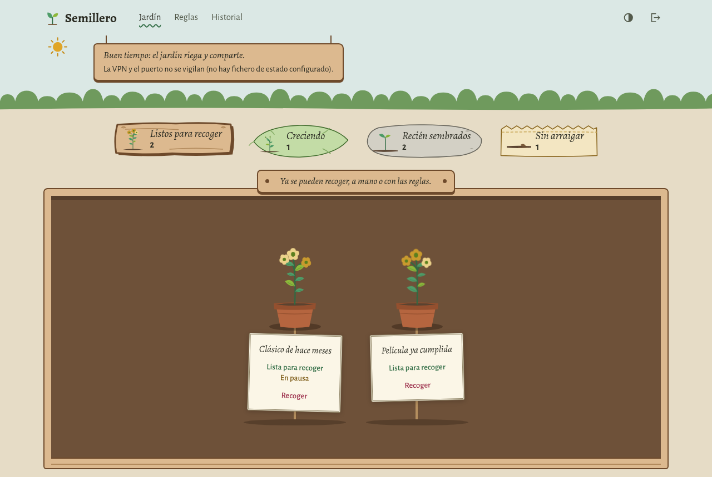
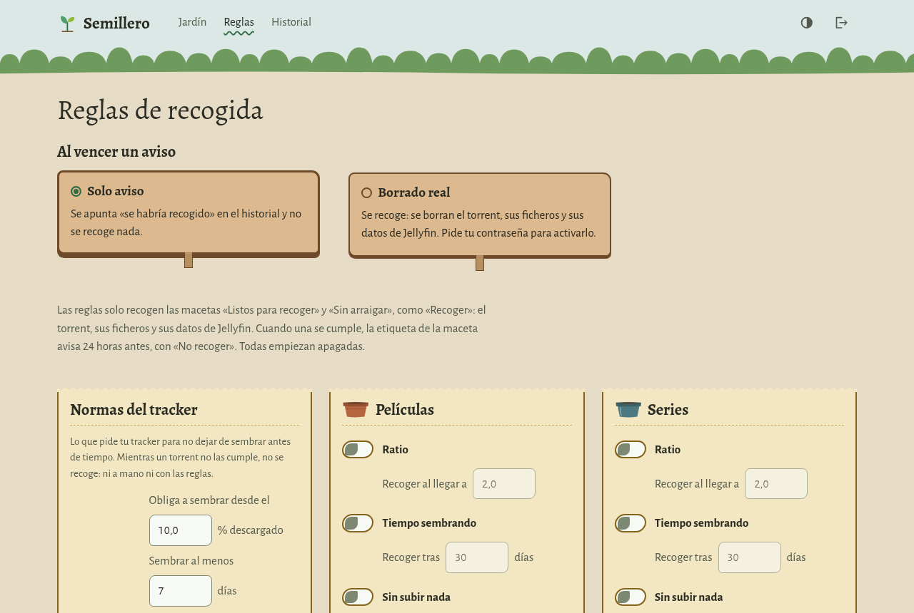
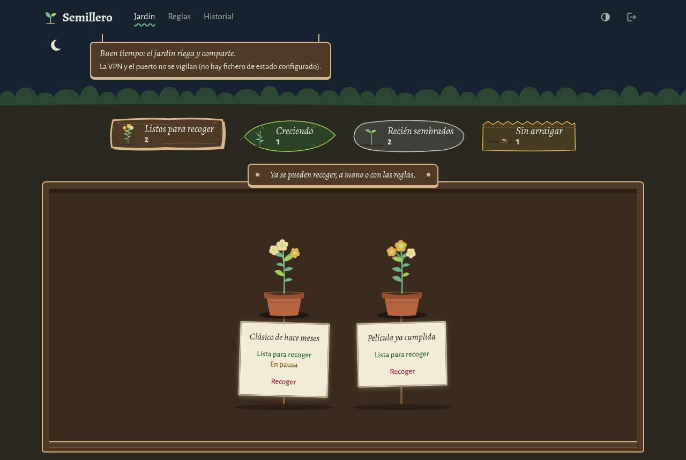
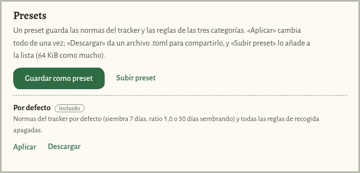
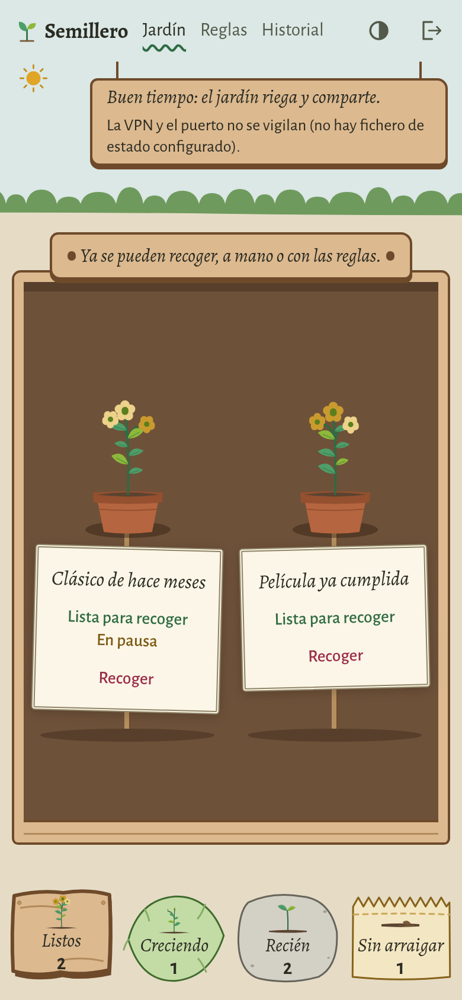

# semillero

[English](README.en.md)

Un jardín para tus torrents de qBittorrent. semillero te dice cuáles ya
cumplieron las normas de siembra de tu tracker privado y cuáles no, y te
deja quitarlos, a mano o con reglas, sin romper esas normas.

Es para quien usa qBittorrent con un tracker privado, tiene el disco
lleno y no quiere ir torrent a torrent mirando ratio y días de siembra.



<table>
<tr>
<td width="50%"></td>
<td width="50%"></td>
</tr>
<tr>
<td>Reglas: normas del tracker y reglas por categoría.</td>
<td>Tema oscuro, según el sistema o con el botón de la cabecera.</td>
</tr>
<tr>
<td></td>
<td rowspan="2"></td>
</tr>
<tr>
<td>Presets para guardar y compartir normas y reglas.</td>
</tr>
</table>

Las capturas son del modo de prueba, con el qBittorrent simulado (ver
[Probarlo sin qBittorrent](#probarlo-sin-qbittorrent)).

## Qué hace

- **Clasifica cada torrent** según las normas del tracker:
  - «Recién sembrados»: aún tienen que sembrar; no se tocan.
  - «Creciendo»: ya sembraron los días, pero les falta ratio.
  - «Listos para recoger»: cumplieron; se pueden quitar.
  - «Sin arraigar»: casi no se descargaron; no cuentan para el tracker.
- **Normas del tracker configurables**: descarga mínima para que cuente,
  días de siembra, ratio mínima, plazo máximo, ratio para pararlo y horas de
  aviso. Los valores de partida son los de un tracker privado habitual.
- **Reglas de borrado por categoría**: ratio, tiempo sembrando, inactividad
  y espacio libre en disco. Solo afectan a torrents que ya cumplieron o que
  no cuentan.
- **Siempre avisa antes**: cada borrado automático sale primero en «A punto
  de borrarse», con cuenta atrás y un botón para impedirlo.
- **Presets que se comparten**: guarda tus normas y reglas en un archivo,
  descárgalo, súbelo en otro semillero y aplícalo.
- **Borrado real con contraseña**: al estrenarlo solo avisa. Para que borre
  de verdad, lo activas tú y te pide la contraseña.
- **Jellyfin, si quieres**: tras borrar, le pide a la mediateca que lo
  olvide.
- **Estado de la VPN y del puerto, si quieres**: lee un fichero de estado;
  si la VPN o el puerto fallan, ninguna cuenta atrás avanza.
- **Historial** de todo lo que pasa.

semillero no guarda contraseñas: entras con el usuario y la contraseña de
qBittorrent.

## Probarlo sin qBittorrent

El repositorio trae un qBittorrent simulado con torrents de muestra. Hace
falta Rust (`rustup`) y cargo-leptos:

```sh
git clone https://github.com/m4rz3r0/semillero.git
cd semillero
cargo install --locked cargo-leptos --version 0.3.11
cargo leptos build
cargo run -p qbt-sim --example demo
```

El simulador escribe su dirección, por ejemplo `http://127.0.0.1:39921`.
En otra terminal, desde la misma carpeta:

```sh
SEMILLERO_QBT=http://127.0.0.1:39921 LEPTOS_SITE_ROOT=target/site ./target/debug/semillero
```

Abre `http://127.0.0.1:8090` y entra con el usuario `admin` y la
contraseña `secreta`. La base de datos de prueba queda en `semillero.db`,
en esa carpeta. Para parar, `Ctrl+C` en las dos terminales.

## Instalar

Cada versión publica paquetes para Linux (x86_64 y aarch64), Windows
(x86_64) y FreeBSD (x86_64), una imagen de contenedor y `SHA256SUMS`, con
atestación de procedencia: puedes comprobar que salieron de la CI de este
repositorio.

1. [Preparar qBittorrent](docs/instalar/qbittorrent.md) (para todas).
2. Una de estas:
   - [Linux con podman](docs/instalar/linux-podman.md) (imagen y quadlet)
   - [Linux con systemd](docs/instalar/linux-systemd.md) (paquete y unidad endurecida)
   - [FreeBSD](docs/instalar/freebsd.md) (en una jail, a mano o con actualizador)
   - [Windows](docs/instalar/windows.md) (zip a mano, o podman)
   - [A mano, en cualquier sistema](docs/instalar/a-mano.md)

Sustituye `X.Y.Z` por la versión.

## Configuración

Todo va por variables de entorno. Todas son opcionales: sin ninguna,
semillero escucha solo en este equipo.

La forma fácil es `semillero configurar`: pregunta las direcciones y las
claves, las comprueba contra qBittorrent y Jellyfin y escribe el fichero
`VARIABLE=valor` que lee cada forma de instalar (las guías dicen dónde),
con la contraseña de qBittorrent y la clave de Jellyfin aparte, en ficheros
solo para su dueño. Para cambiar algo, se vuelve a ejecutar.

| Variable | Qué es | Por defecto |
|---|---|---|
| `SEMILLERO_LISTEN` | dónde escuchar: `IP:puerto`, o solo la IP y el puerto en `SEMILLERO_PORT` | `127.0.0.1:8090` |
| `SEMILLERO_PORT` | puerto, si `SEMILLERO_LISTEN` es solo una IP | `8090` |
| `SEMILLERO_QBT` | dirección de la API web de qBittorrent | `http://127.0.0.1:8080` |
| `SEMILLERO_QBT_CLAVE` | fichero con la contraseña de la interfaz web de qBittorrent: modo con contraseña ([Preparar qBittorrent](docs/instalar/qbittorrent.md)) | ninguno: modo lista blanca |
| `SEMILLERO_QBT_USUARIO` | usuario de qBittorrent en el modo con contraseña | `admin` |
| `SEMILLERO_LOGIN_DESDE` | IP de origen al comprobar contraseñas; no puede estar en la lista blanca de qBittorrent | `127.0.0.1` en modo lista blanca; en modo con contraseña, la que elija el sistema |
| `SEMILLERO_DB` | base de datos SQLite | `semillero.db` en la carpeta de trabajo |
| `SEMILLERO_ORIGEN` | direcciones desde las que se usa la web, separadas por comas | `http://127.0.0.1:<puerto>,http://localhost:<puerto>` |
| `SEMILLERO_PROXY` | IP del proxy inverso; solo de ella se cree `X-Forwarded-For` | ninguna: vale la IP de la conexión |
| `SEMILLERO_ESTADO` | fichero de estado de la VPN y del puerto | ninguno: no se vigilan |
| `SEMILLERO_JELLYFIN` | dirección de Jellyfin | ninguna: sin Jellyfin |
| `SEMILLERO_JELLYFIN_CLAVE` | fichero con la clave de la API de Jellyfin | `jellyfin.clave` junto a la base de datos |
| `SEMILLERO_LOG` | nivel de registro (`error`, `warn`, `info`, `debug`) | `info` |
| `LEPTOS_SITE_ROOT` | carpeta de la web (WASM, JS y CSS) | `site` junto al ejecutable |

`<puerto>` es el de `SEMILLERO_LISTEN`. La contraseña de qBittorrent y la
clave de Jellyfin van en un fichero cada una, solo para el dueño (`chmod
600`), y no en una variable porque las variables se ven en la lista de
procesos.

El fichero de `SEMILLERO_ESTADO` lo escribe el programa que mantiene la VPN
y abre el puerto, al menos cada 45 segundos, con estas líneas:

```text
escrito_en=<segundos Unix de esta escritura>
handshake=<segundos Unix del último saludo del túnel>
puerto=<puerto reenviado, o vacío>
fallos=<renovaciones seguidas del puerto que han fallado>
```

## Seguridad

- No guarda las contraseñas de quien entra: las comprueba contra
  qBittorrent. En el modo con contraseña, la suya propia para qBittorrent
  va en un fichero aparte, solo para el dueño.
- Sesión en cookie `__Host-`, CSRF con `Origin` y token, CSP con nonce.
- Freno de intentos por dirección del cliente, no por usuario.
- Pide otra vez la contraseña para borrar de verdad y, con el borrado real
  activo, para cambiar normas, reglas o preset.
- Al público no le dice la versión.

Para entrar desde otro equipo, ponlo detrás de un proxy inverso con HTTPS:
la cookie de sesión solo viaja por HTTPS (o a `127.0.0.1`). Pon la dirección
pública en `SEMILLERO_ORIGEN` y la IP del proxy, y solo esa, en
`SEMILLERO_PROXY`. Más en [SECURITY.md](SECURITY.md), también cómo avisar de
un fallo.

## Más

- [Diseño](docs/diseno.md): cómo clasifica, cómo borra y el formato de los presets.
- [Hoja de ruta hacia la 1.0](ROADMAP.md) y [registro de cambios](CHANGELOG.md)
- [Contribuir](CONTRIBUTING.md)
- [Aviso legal](AVISO-LEGAL.md): marcas, riesgo de borrado y tus normas.

## Licencia

MIT ([LICENSE](LICENSE)). qBittorrent y Jellyfin son marcas de sus dueños;
semillero no tiene relación con ellos.
